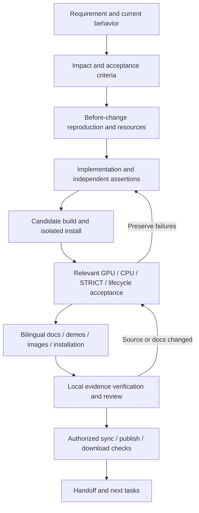

# Complete AI development workflow

[中文](AUTONOMOUS_WORKFLOW.md) | English

For features, compatibility fixes, refactoring, builds/releases, and developer-tool changes. Follow [AGENTS](../../../AGENTS.md) required readings first. This is the current execution workflow; [WORKFLOW](WORKFLOW.en.md) supplies build/comparison commands and [DOCUMENTATION](DOCUMENTATION.en.md) defines documentation delivery. Machine rules are in [workflow.json](workflow.json); feasibility is reviewed in [WORKFLOW_AUDIT](WORKFLOW_AUDIT.en.md).

## 1. Automation scope and completion states

AI can independently decompose requirements, implement, schedule tests, update docs/images, repair failures, and perform authorized synchronization. Existing CLIs execute builds, actual-wheel capture, exact comparison, CPU matrices, traces, and publication. Hardware, fonts, desktops, and accounts must actually exist; changing compatibility scope remains a user decision.

Report `planned`, `implemented`, `scoped_verified`, `release_accepted`, and `published` separately. The new `CHANGE_COVERAGE_CHECKED` status only checks relationships among changes, documentation, and check records. It is no rendering/release certification. Automation cannot prove an arbitrary new feature has no defects.



## 2. Accept the task, freeze the starting point, and plan

Inspect Git and existing edits, read current release records, and express the requirement as decidable inputs, outputs, errors, platforms/backends, and ownership constraints. Distinguish fixes to official 3.0.8 behavior from extensions outside that baseline. Obtain an explicit compatibility decision for the latter; do not independently change algorithms or default GPU behavior.

If users have uncommitted edits, record them and assess overlap; use an isolated Git worktree when needed. The tool compares the entire working tree with its Git base and cannot infer authorship. Do not treat existing edits as this task's implementation, commit them incidentally, or assume HEAD saved the dirty working tree.

Create a fresh record from the repository root. Names use unused lowercase letters, numbers, and hyphens:

```shell
python scripts/dev_workflow.py init --base HEAD --kind compatibility --areas arguments,rendering --objective "Fix the specified Canvas contract" --record docs/changes/my-canvas-change-001.json
```

The tool freezes `baseCommit`, source hashes, documentation topics, and unexecuted checks. It neither implements nor assumes success. Fill `acceptanceCriteria`, `environment`, and `decisions`: actual interpreters, official A module, candidate wheel, font manifest, GPU/desktop availability, scope, and existing task authorization. Do not record tokens/recovery codes or credentials.

## 3. Let impact determine tests and documentation

Choose `documentation`, `tooling`, `compatibility`, `extension`, or `packaging` as kind. Combine areas according to semantic impact, not filenames alone. Production changes cannot be labeled tooling.

| Area | Additional checks | Documentation impact |
| --- | --- | --- |
| arguments | Normal/STRICT, conversion order, errors, side effects | API |
| rendering | Exact default GPU and CPU scenes | API, usage, demos |
| text | GPU/CPU and actual drawn glyph/face/fallback | API, fonts, demos |
| images | GPU/CPU, pixel formats, resource lifetimes | API, loading/pixels, demos |
| exports | GPU/CPU, relevant formats/pages/snapshots, lifecycle | API, exports/pages, demos |
| ownership | Threads, GC, async, shutdown, GPU/CPU | API, parallel/async usage |
| gui | Main-thread real windows, events, close/restart | API, windows, demos |
| native | Actual backends, CPU, lifecycle; build/link scope | Development/provenance |
| packaging | Isolated installs, metadata, licenses, deployment | Installation, release |
| tooling / documentation | Tool assertions, bilingual/links/example consistency | Development / entry points |

Complex tasks include every affected area. Investigate unknown impact before selecting. Release acceptance additionally covers full Windows/Linux targets, loader-less deployment, and exact-byte publication; this minimum development matrix does not replace it.

## 4. Reproduce before editing, then implement

Preserve official A and previous implementation outputs to establish the trigger. Regression assertions must detect the original issue. Record source functions, read/conversion order, units, and resources. Preserve user edits and original algorithms outside the binding boundary. Document each new function's parameters, units, return, exceptions, thread/ownership constraints, and upstream source.

Transfer only safe data across threads. Native drawing objects stay on their creator; never move an existing GPU context into an executor. Preserve each failure in a fresh run rather than adjusting old oracle data, tolerances, or results.

Refresh source hashes after implementation:

```shell
python scripts/dev_workflow.py refresh --record docs/changes/my-canvas-change-001.json
```

Changed source moves old checks to `previousChecks` and marks current checks unexecuted without overwriting old evidence files. If kind/areas change, add the newly required checks/topics from policy; do not delete inconvenient requirements.

## 5. Build, isolate, and verify behavior

Production/packaging edits need a new candidate wheel, verified outside the repository with empty PATH and `-I` as in [WORKFLOW](WORKFLOW.en.md). Old published wheels are pre-change references only. Once platform paths for Node A, Python, manifests, and fixtures are configured, existing CLIs can execute normal/STRICT, GPU/CPU, exports, lifecycles, and relevant native observations.

Keep actual commands/exit codes, wheel/native hashes, fonts/drivers, inputs, outputs, and comparisons. `before_after` refers to a reviewed summary linking reproduction and corrected results. `contract_diff` must compare actual official A with the new wheel, not A with itself. Record platforms, modes, and backends separately rather than concealing gaps.

With missing resources, continue independent work, name the missing condition and recovery step, and retain unaccepted status. Never silently skip or create blank images. CPU does not replace GPU. Window presentation retains the original GPU requirement; default Windows vector-sequence nondeterminism and explicit serial diagnostics remain separate.

## 6. Finish documentation before final source checks

Follow [DOCUMENTATION](DOCUMENTATION.en.md) to update Chinese/English API, usage, demos, image provenance, installation/version, and development/release material in the same batch. Run changed/new examples on the actual new wheel and inspect output. For unchanged topics, record specific reviewed reasons and paths instead of a cursory “no impact.”

`facts.version` / `installation.version` describe the public documentation/installed release; `sourceVersion` describes the source candidate. Image provenance uses `acceptedWheels.version`. Raising the candidate version must not prematurely claim a PyPI release. PyPI descriptions come from upload-time README content; GitHub pushes cannot update old release descriptions.

## 7. Run unified checks and attach real evidence

This run executes only bootstrap/core/licenses, AI documentation, and workflow-tool assertions. Actual-wheel/rendering checks are separate as above:

```shell
python scripts/dev_workflow.py run --record docs/changes/my-canvas-change-001.json --out test-runs/my-canvas-change-001/source-01
python scripts/dev_workflow.py attach --record docs/changes/my-canvas-change-001.json --id source --report test-runs/my-canvas-change-001/source-01/run.json --command python scripts/dev_workflow.py run --record docs/changes/my-canvas-change-001.json --out test-runs/my-canvas-change-001/source-01
python scripts/dev_workflow.py attach --record docs/changes/my-canvas-change-001.json --id docs --report test-runs/my-canvas-change-001/source-01/docs.json --command python scripts/validate_ai_docs.py
```

Tooling tasks also attach `tooling_tests.json`; other tasks attach real reports/commands for their required IDs. `attach` reads an existing report, checks successful status/context, and computes SHA. It executes no command and invents no passing result. Complex native checks still require reviewing objects, scope, and original attachments; a JSON success label cannot establish semantics by itself.

Finally verify locally:

```shell
python scripts/dev_workflow.py check --record docs/changes/my-canvas-change-001.json --verify-evidence --out test-runs/my-canvas-change-001/coverage-01.json
```

Subsequent documentation edits invalidate doc evidence; source edits invalidate hashes/context. Rerun affected checks in new directories. Records assist recovery rather than bypass failed checks.

## 8. Review, synchronize, publish, and hand off

Review diffs, API inventory/source mapping, documentation accuracy, images, and evidence scope. CI computes actual differences from PR base / push before, checking that code/tool edits have records with matching source hashes and documentation reviews. Without local GPU artifacts, CI checks records only.

Commit/push within current authorization and read actual CI status. If publication is included, follow [TESTING_AND_RELEASE](TESTING_AND_RELEASE.en.md): freeze accepted bytes and verify Actions, Release, TestPyPI, and PyPI separately. Inspect packaged installation instructions before upload, then actual index version/description/file hashes after download. GitHub documentation status is not PyPI status.

Handoff includes implemented/unfinished work, each acceptance criterion, source/candidate hashes, commands/run paths, bilingual docs/demos, real resource limitations, authorization scope, and next step. A new session reads `baseCommit`, `previousChecks`, `limitations`, and `nextStep` to continue without rebuilding from scratch or counting old results as new checks.

## 9. Ready-to-use AI task prompt

```text
Goal: <specific behavior, inputs/outputs, platforms, visible results>.
Read AGENTS.md prerequisites and AUTONOMOUS_WORKFLOW.en.md / DOCUMENTATION.en.md.
Target official skia-canvas 3.0.8; preserve the single core and original GPU/CPU policy.
Inspect existing edits/resources; create docs/changes/<new-id>.json and freeze the base.
Record acceptance criteria, semantic areas, environment, existing authorization, and decisions.
Reproduce and preserve before-change evidence, then implement independent assertions and fixes.
For production changes, build/install a new candidate and compare against A across relevant
normal/STRICT/GPU/CPU/lifecycle checks. Update bilingual API/usage/install/demo/image/development/
release docs in the same batch; explain unchanged reviewed topics.
Refresh source hashes, finish checks, attach real reports, verify evidence and doc versions locally.
Preserve failures; use fresh runs after fixes. Missing resources remain unaccepted while other work continues.
Perform synchronization/publication within current authorization and verify external steps separately.
Deliver per-criterion results, evidence, documentation, limitations, and a resumable next step.
CI success is not complete feature acceptance.
```
