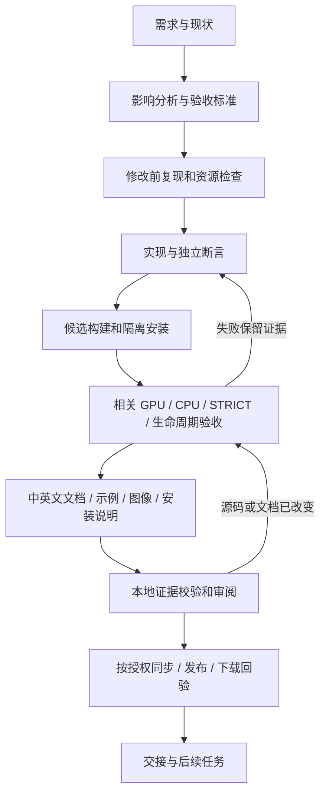

# AI 研发完整流程

中文 | [English](AUTONOMOUS_WORKFLOW.en.md)

适用于新功能、兼容修复、重构、构建/发布和研发工具修改。先遵守 [AGENTS](../../../AGENTS.md) 的必读资料；本页是当前执行流程，[WORKFLOW](WORKFLOW.md) 提供构建/差分命令，[DOCUMENTATION](DOCUMENTATION.md) 规定同批文档交付。机器规则在 [workflow.json](workflow.json)，实施可行性审查见 [WORKFLOW_AUDIT](WORKFLOW_AUDIT.md)。

## 1. 自动化范围和完成状态

AI 可以自主完成需求拆解、实现、测试调度、文档/图片、故障修复及已授权的同步。现有 CLI 能执行构建、真实 wheel 捕获、精确比较、CPU matrix、trace 与发布。但是硬件、字体、桌面和账号能力必须实际具备；改变固定兼容范围仍由用户决定。

阶段分别报告：`planned`、`implemented`、`scoped_verified`、`release_accepted`、`published`。它们不能互换。新工具的 `CHANGE_COVERAGE_CHECKED` 只说明变更、文档与检查记录之间的关系满足检查，不是渲染或发布认证。自动化不能证明任意新功能绝无缺陷。



## 2. 接单、冻结起点并创建计划

检查 Git 状态和现有修改，读取当前发行记录；把需求写成可判定的输入、输出、异常、平台/后端及所有权要求。区分官方 3.0.8 已有行为的修复，与超出固定基线的新扩展。后者先取得明确的兼容决策，不自动改变渲染算法或默认 GPU。

若起点含用户未提交的改动，先登记并判断交叉影响，必要时使用隔离 Git worktree。工具按 Git base 比较整个工作树，不会自动区分修改作者；不能把用户原有改动默认为本批实现或一并提交，也不能把 HEAD 当作已保存脏树的快照。

在仓库根目录创建新记录；名称须为未使用的小写字母、数字或连字符：

```shell
python scripts/dev_workflow.py init --base HEAD --kind compatibility --areas arguments,rendering --objective "Fix the specified Canvas contract" --record docs/changes/my-canvas-change-001.json
```

工具冻结 `baseCommit`，生成源码 SHA、待审文档和未执行检查，不执行实现或假定通过。随后填写 `acceptanceCriteria`、`environment`、`decisions`：实际解释器、官方 A 模块、候选 wheel、字体 manifest、GPU/桌面能力、验收范围与本次已有授权。不得记录 token/恢复码或其他凭据。

## 3. 影响分析决定测试和文档

`kind` 为 `documentation`、`tooling`、`compatibility`、`extension` 或 `packaging`。`areas` 可组合；以语义影响为准，不能只看文件名，也不能把生产改动标为 tooling。

| area | 额外检查 | 文档影响 |
| --- | --- | --- |
| arguments | 普通/STRICT、转换顺序、异常和副作用 | API |
| rendering | 默认 GPU 与 CPU 精确场景 | API、使用、demo |
| text | GPU/CPU、实际 draw glyph/face/fallback | API、字体、demo |
| images | GPU/CPU、像素格式及资源生命周期 | API、加载/像素、demo |
| exports | GPU/CPU、全部相关格式/页/快照、生命周期 | API、导出/多页、demo |
| ownership | 线程、GC、异步、退出和 GPU/CPU | API、并行/异步 |
| gui | 主线程真实窗口、事件、关闭/重启 | API、窗口、demo |
| native | 实际后端、CPU、生命周期；构建/链接范围 | 开发/来源 |
| packaging | 隔离安装、元数据、许可、部署 | 安装、发行 |
| tooling / documentation | 工具断言、双语/链接/示例一致性 | 开发 / 入口 |

复杂需求覆盖所有相关 area；未知影响先调查再选。发行验收还要覆盖 Windows/Linux 完整目标、无 loader 部署和同字节发布，不能由此表的最小开发检查替代。

## 4. 修改前复现与实现

先保存官方 A 和旧实现结果，证明触发条件；回归断言必须能检测原问题。记录来源函数、读取/转换顺序、单位和资源。保留用户修改；语言边界外的原算法不重写。新函数给出参数、单位、返回、异常、线程/所有权及上游位置。

跨线程只传可转移数据。原生绘图对象始终留在创建线程；不能用线程池搬动现有 GPU context。修复过程中每次失败保留新 run，不改旧 oracle、容差或结果。

实现后刷新记录中的源码 SHA：

```shell
python scripts/dev_workflow.py refresh --record docs/changes/my-canvas-change-001.json
```

若源码改变，工具把旧检查移到 `previousChecks` 并置当前检查为未执行；不会覆盖旧证据文件。若修改了 kind/areas，须按机器规则补全新增检查和文档主题，不能仅删除不方便执行的项目。

## 5. 构建、隔离安装和功能验证

生产代码或打包变化必须生成新候选 wheel，再按 [WORKFLOW](WORKFLOW.md) 从仓库外、空 PATH、`-I` 验证。旧发行 wheel 只可用作修改前对照。配置 Node A、Python、manifest 和 fixture 的平台路径后，AI 可用现有 CLI 连续执行普通/STRICT、GPU/CPU、导出、生命周期与必要原生观测。

实际执行的命令、退出码、wheel/native SHA、字体/驱动、输入、输出和比较结果均保留。`before_after` 指向修改前复现与修改后结果的审阅摘要；`contract_diff` 指向真正官方 A↔新 wheel 的比较，而不是 A↔A。不同平台、模式或后端分别记录，不合并隐藏缺项。

缺资源时继续完成独立工作，指出具体缺少的条件和可恢复步骤，状态保留未验收；不静默 skip、不写空图。CPU 不能替代 GPU；窗口不要求新增 CPU 后端。Windows 矢量序列的默认非确定性和显式串行诊断分别说明。

## 6. 文档先于最终源码检查完成

按 [DOCUMENTATION](DOCUMENTATION.md) 同批更新中文/英文 API、使用、demo、图像来源、安装/版本与研发/发行资料。使用实际新 wheel 运行新增/改变的示例；审阅输出。无需变更的主题写明审阅理由和路径，不能填“无影响”草率结束。

`facts.version` / `installation.version` 是公开文档和已发布安装版本；`sourceVersion` 是当前源码候选；图片的 `acceptedWheels.version` 是对应验收基线。候选升级不应让安装说明提前声称该版本已发布。PyPI 简介来自上传时 README，不能靠 GitHub push 更新旧版本说明。

## 7. 执行统一检查并自动附加证据

以下 run 只运行 bootstrap/core/许可、AI 文档和流程工具断言；真实 wheel/渲染检查按上一步另行完成：

```shell
python scripts/dev_workflow.py run --record docs/changes/my-canvas-change-001.json --out test-runs/my-canvas-change-001/source-01
python scripts/dev_workflow.py attach --record docs/changes/my-canvas-change-001.json --id source --report test-runs/my-canvas-change-001/source-01/run.json --command python scripts/dev_workflow.py run --record docs/changes/my-canvas-change-001.json --out test-runs/my-canvas-change-001/source-01
python scripts/dev_workflow.py attach --record docs/changes/my-canvas-change-001.json --id docs --report test-runs/my-canvas-change-001/source-01/docs.json --command python scripts/validate_ai_docs.py
```

tooling 任务还附加 `tooling_tests.json`；其他任务按其检查 ID 附加对应真实报告与实际命令。`attach` 读取既有报告、校验成功状态/上下文并自动计算 SHA，不运行命令，也不凭输入文字制造通过。复杂原生检查仍需审阅其对象、范围和原始附件；一份 JSON 的成功标签不能自行证明语义。

最后本地核对：

```shell
python scripts/dev_workflow.py check --record docs/changes/my-canvas-change-001.json --verify-evidence --out test-runs/my-canvas-change-001/coverage-01.json
```

文档在检查后再改，文档证据失效；源码在检查后再改，源码 SHA/上下文不符。按影响重跑并使用新目录。记录能辅助恢复，不能用于绕过未通过的检查。

## 8. 审阅、同步、发布与交接

审阅差异、API 清单/来源映射、文档准确性、图像和证据范围。CI 从 PR base / push before 计算真实差异，检查代码/工具改动是否有匹配源码 SHA 和文档处理的任务记录；CI 没有本机 GPU 证据时只做记录检查。

按当前授权 commit/push 并读取实际 CI 状态。若本任务包括发布，继续 [TESTING_AND_RELEASE](TESTING_AND_RELEASE.md)：固定验收字节，分别核对 Actions、Release、TestPyPI、PyPI。新版本上传前检查打包后的安装说明，下载后检查索引实际版本/说明/文件 SHA；不把 GitHub 文档状态当成 PyPI 状态。

交接写清：实现与未完成项、需求验收逐条结果、源码/候选 SHA、命令和 run 路径、双语文档与 demo、实际资源限制、授权范围、下一步。新会话读取任务记录的 `baseCommit`、`previousChecks`、`limitations` 和 `nextStep` 后继续，避免从零重建或把旧结果算作新检查。

## 9. 可直接交给 AI 的任务模板

```text
目标：<具体行为、输入输出、平台、可见结果>。
先读 AGENTS.md 必需资料及 AUTONOMOUS_WORKFLOW.md / DOCUMENTATION.md。
基线固定官方 skia-canvas 3.0.8；保留唯一核心及原 GPU/CPU 策略。
检查已有修改和资源，创建 docs/changes/<新id>.json，冻结起点。
填写验收标准、语义影响 area、环境、已有授权和决策。
先复现并保存修改前证据，再实现及补充独立断言。
生产改动构建新候选并隔离安装，对照 A 完成相关普通/STRICT/GPU/CPU/生命周期检查。
同批更新中英文 API/使用/安装/demo/图片/研发/发行文档；未改项说明审阅理由。
刷新源码 SHA，完成最终检查，附加真实报告，本地验证证据及文档版本。
失败保留原始结果，修复后使用新 run；缺资源只保留未验收项，继续其他独立工作。
按本次已有授权完成同步或发布，并分别验证外部结果。
交付逐条验收、证据、文档、限制和可恢复的下一步；不以 CI 成功冒充完整功能验收。
```
